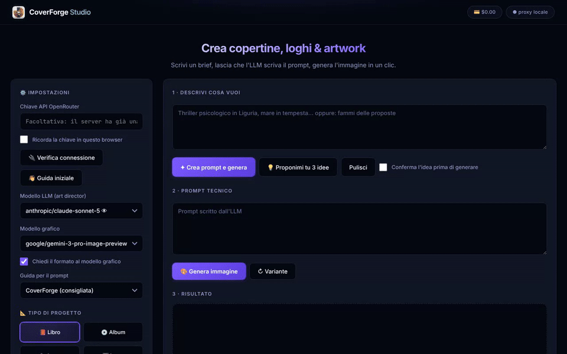

# CoverForge Studio

[Italiano](README.md) · **English**

Book and album covers, logos, icons, headers and featured images for blog posts. Describe what you need: a text model acts as art director and writes the prompt, an image model creates the picture (through [OpenRouter](https://openrouter.ai)). Then you can edit it, set the title on top and export it.

> **Note:** the interface and the prompt guide are in Italian. Briefs can be written in any language the models understand.



<sub>The demo runs against a simulated OpenRouter and the cover is a sample drawing made for this page, not a generated result.</sub>

## Why try it

- **No prompt writing skills needed.** Before writing the prompt, the art director lists the most obvious images for the theme and discards them. With *Conferma l'idea* (confirm the idea) you see the idea before spending credits on the image.
- **It reads your texts.** Attach chapters, song lyrics, a brand brief or a blog post: the app pulls out characters, mood, tone and themes, depending on the kind of project.
- **It learns your taste.** Star the images you like and the app builds a style profile that steers later prompts.
- **Real editing.** Changes described in words or painted on a zone, reframing to a new aspect ratio without cropping, before/after comparison, linked versions.
- **No subscription.** Pick any text and image model available on OpenRouter and pay only for what you use. The cost of every operation is always shown.
- **Local first.** History, files and images stay on your computer. The server listens on localhost only, fonts are bundled, and the prompt guide is a plain text file you can read and edit.

## What you need

An [OpenRouter](https://openrouter.ai) account with some credit and an API key ([openrouter.ai/keys](https://openrouter.ai/keys)). On first launch a welcome window walks you through it: paste the key, check it, and pick a model combination (*Economica*, budget, or *Qualità*, quality) chosen among the models available at that moment.

## Install

### Installer (recommended, no Node.js needed)

Download the package for your system from [Releases](https://github.com/querogiuseppe61-stack/coverforge-studio/releases):

- **Windows**: `CoverForge-Studio-<version>-Setup.exe`. It is not code-signed: if you see "Windows protected your PC", choose *More info* → *Run anyway*.
- **macOS**: the `.dmg` for your processor (`arm64` for Apple Silicon, `x64` for Intel); drag the app into *Applications*. It is not signed: the first time, right-click → *Open*. If macOS says the app is "damaged", run `xattr -cr "/Applications/CoverForge Studio.app"` in Terminal.
- **Linux**: the `AppImage`. Make it executable (`chmod +x CoverForge-Studio-*.AppImage`) and run it; some distributions need `libfuse2`. To add it to the applications menu with its icon, open it with Gear Lever or AppImageLauncher.

Data (database, images, attachments, log) lives in the app's user folder: `%APPDATA%\CoverForge Studio` on Windows, `~/Library/Application Support/CoverForge Studio` on macOS, `~/.config/CoverForge Studio` on Linux.

### From source (Node.js 20.3 or later)

Download the project (*Code* → *Download ZIP*, or `git clone`) and start it:

- **Windows**: double-click `CoverForge.cmd`.
- **macOS**: double-click `CoverForge.command` (first time: right-click → *Open*).
- **Linux**: `bash coverforge.sh`; `bash install-desktop.sh --menu --desktop` adds a launcher to the menu and the desktop.
- **Anywhere**: `npm run web`.

The first run installs the dependencies, then the server starts and the browser opens at http://localhost:3000. The key can be typed in the interface or put in `.env` (copy `.env.example` to `.env` and fill in `OPENROUTER_API_KEY`).

## Costs

OpenRouter reports what it charged in every response. The app logs the cost of each operation (text, image, style profile), adds up the session total in the 💳 badge at the top, and stores in the history what each image cost to make.

## What else it does

- **Blog featured images**: attach the article and the art director reads it in full, writes down topic, tone and spirit, and builds the image around them.
- **Title overlay**: a mask with presets (book cover, album, blog image) to set title and author with bundled fonts.
- **Aspect ratio**: requested from the image model through OpenRouter's `image_config.aspect_ratio` when supported, with an automatic retry without it when a model rejects the parameter.
- **Vectorize (SVG)**: local tracing to flat-color SVG, best for logos and icons. Nothing is sent anywhere.

The [Italian README](README.md) documents every feature in detail.

## Tests

```bash
npm run check                     # syntax check of every JavaScript file
npx playwright install chromium   # first time only: browser for the UI tests
npm test                          # automated tests
```

Tests never call OpenRouter: a fake OpenRouter answers in its place, so no key is needed and nothing is spent. GitHub Actions also builds the three installers and smoke-tests each package.

## License

[MIT](LICENSE). The excerpts in `prompt-master-main/` come from *Prompt Master* by Nidhin Joseph Nelson (MIT). The fonts in `public/fonts/` are under the SIL Open Font License 1.1.
