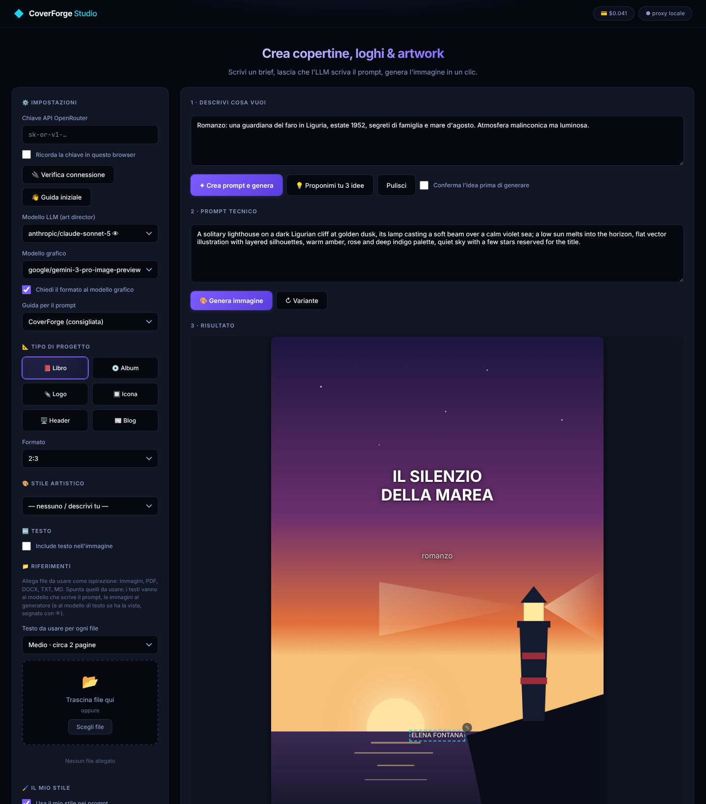

# CoverForge Studio

Copertine di libri e dischi, loghi, icone, header e immagini per articoli di blog. Scrivi in italiano che cosa ti serve: un modello di testo fa da art director e scrive il prompt, un modello grafico crea l'immagine (tramite [OpenRouter](https://openrouter.ai)). Poi puoi modificarla, comporre il testo sopra ed esportarla.



<sub>L'immagine nella schermata è un disegno d'esempio fatto per questa pagina, non un risultato generato.</sub>

## Perché provarla

- **Non serve saper scrivere prompt.** Prima di scrivere il prompt, l'art director elenca le immagini più ovvie per il tema e le scarta; con *Conferma l'idea* vedi l'idea prima di spendere crediti per l'immagine.
- **Legge i tuoi testi.** Allega capitoli, testi di canzoni, il brief di un marchio o un articolo: l'app ne ricava personaggi, atmosfera, tono, a seconda del tipo di progetto.
- **Impara il tuo gusto.** Segna le immagini che ti piacciono e l'app ne ricava un profilo di stile, che orienta i prompt successivi.
- **Modifica completa.** Ritocchi descritti a parole o su una zona segnata, cambio di formato senza tagli, confronto prima/dopo, versioni collegate.
- **Nessun abbonamento.** Scegli qualunque modello di testo e d'immagine disponibile su OpenRouter e paghi solo quello che usi; il costo di ogni operazione è sempre visibile.
- **Tutto in locale.** Cronologia, file e immagini stanno sul tuo computer; il server ascolta solo in locale, i font sono inclusi, la guida dei prompt è un file di testo che puoi leggere e modificare.

## Che cosa serve

Un account [OpenRouter](https://openrouter.ai) con un po' di credito e una chiave API ([openrouter.ai/keys](https://openrouter.ai/keys)). Al primo avvio una finestra di benvenuto ti guida: incolli la chiave, la verifichi e scegli una combinazione di modelli («Economica» o «Qualità»), presa fra i modelli disponibili in quel momento. La puoi riaprire con *👋 Guida iniziale* nelle impostazioni.

La chiave può anche essere scritta nel campo "Chiave API" dell'interfaccia: viene ricordata nel browser solo se spunti "Ricorda la chiave", e viaggia solo verso il server locale. Il file `.env` non va mai condiviso né messo in un repository. Il pulsante **Verifica connessione** (nelle impostazioni) controlla che OpenRouter sia raggiungibile e che la chiave funzioni, e mostra i dati di spesa. Il saldo del conto lo legge solo una *management key* di OpenRouter; con una chiave normale vedi il limite di spesa impostato sulla chiave (se c'è) e quanto hai speso con essa, mentre il saldo si controlla nella pagina Credits dell'account su openrouter.ai.

## Installazione

### Con il programma di installazione (consigliato, non serve Node.js)

I pacchetti per Windows, macOS e Linux vengono costruiti dal workflow *Pacchetti di installazione* di GitHub Actions. Quando viene pubblicata una versione li trovi nella pagina [Releases](https://github.com/querogiuseppe61-stack/coverforge-studio/releases); altrimenti tra gli *Artifacts* dell'ultima esecuzione del workflow, nella scheda *Actions*.

Per pubblicare una versione: aggiorna `version` in `package.json`, poi in *Actions* → *Pacchetti di installazione* → *Run workflow* scrivi la versione (per esempio `v2.1.0`). Il workflow costruisce e prova i pacchetti e li allega a una release in bozza; controllala e pubblicala, e GitHub crea il tag.

- **Windows**: `CoverForge-Studio-<versione>-Setup.exe`. Il programma non è firmato: se compare «Windows ha protetto il PC», scegli *Ulteriori informazioni* → *Esegui comunque*.
- **macOS**: il `.dmg` per il tuo processore (`arm64` per Apple Silicon, `x64` per Intel); trascina l'app in *Applicazioni*. Non è firmata: la prima volta aprila con il tasto destro → *Apri*. Se macOS dice che è «danneggiata», in Terminale: `xattr -cr "/Applications/CoverForge Studio.app"`.
- **Linux**: l'`AppImage`. Rendila eseguibile (`chmod +x CoverForge-Studio-*.AppImage`) e aprila; su alcune distribuzioni serve il pacchetto `libfuse2`. Un'AppImage non si installa da sola: per averla nel menu delle applicazioni, con l'icona, aprila con Gear Lever o AppImageLauncher. Per un collegamento sulla scrivania copia nella cartella Scrivania il file `.desktop` che lo strumento ha creato in `~/.local/share/applications`, poi clic destro → *Consenti l'avvio*.

Nell'app installata i dati (database, immagini, file allegati, log, `.env` facoltativo e una copia modificabile della guida `prompt-guide/cover-forge.md`) stanno nella cartella utente dell'app: `%APPDATA%\CoverForge Studio` su Windows, `~/Library/Application Support/CoverForge Studio` su macOS, `~/.config/CoverForge Studio` su Linux.

### Dai sorgenti (serve Node.js 20.3 o successivo)

Scarica il progetto (*Code* → *Download ZIP*, oppure `git clone`) e avvialo:

- **Windows**: doppio clic su `CoverForge.cmd`.
- **macOS**: doppio clic su `CoverForge.command` (la prima volta: tasto destro → *Apri*).
- **Linux**: `bash coverforge.sh` (vedi sotto).
- **Ovunque**: `npm run web`.

Al primo avvio vengono installate le dipendenze; poi parte il server e si apre il browser su http://localhost:3000. La chiave si può scrivere nell'interfaccia oppure in `.env` (copia `.env.example` in `.env` e compila `OPENROUTER_API_KEY`). Per costruire tu i pacchetti: `npm install`, poi `npm run dist` (crea quello del sistema su cui ti trovi, nella cartella `dist/`).

### Avvio da terminale su Linux

```bash
bash coverforge.sh              # finestra Electron se installato, altrimenti browser
bash coverforge.sh --web        # server + browser; Ctrl+C ferma tutto
bash coverforge.sh --electron   # solo la finestra Electron
bash coverforge.sh --silent     # server in background + browser, senza bisogno di un terminale
bash coverforge.sh --stop       # ferma il server avviato con --silent o --web
```

Oppure `npm start` (solo server, http://localhost:3000) e `npm run electron`.

La finestra Electron è una sola alla volta, non apre mai pagine esterne al suo interno (i link vanno al browser di sistema) e nega tutti i permessi del browser. Se il server non parte mostra una finestra con le ultime righe del log e le scelte *Riprova / Apri il log / Modalità diretta / Esci*.

- Se l'app è già in esecuzione, `--web` e `--silent` la riutilizzano invece di avviarne un'altra.
- Se la porta è occupata da un altro programma lo script lo dice e non tocca nulla: cambia `PORT` in `.env`.
- Il server ascolta solo su `127.0.0.1`.
- Il log è in `coverforge.log` (ruotato a 1 MB, la copia precedente è `coverforge.log.1`).

### Icona nel menu / doppio clic

```bash
bash install-desktop.sh                    # rigenera coverforge-studio.desktop con il percorso attuale
bash install-desktop.sh --menu             # in più lo aggiunge al menu delle applicazioni
bash install-desktop.sh --menu --desktop   # menu e collegamento sulla scrivania
```

Rilancialo se sposti la cartella del progetto o dopo un aggiornamento che cambia l'icona. Se sulla scrivania l'icona appare grigia: clic destro → *Consenti l'avvio*.

## Costi

OpenRouter indica in ogni risposta quanto ha addebitato. L'app scrive il costo di ogni operazione nel registro (testo, immagine, profilo di stile) e somma la spesa della sessione nel badge 💳 in alto; in cronologia ogni immagine riporta quanto è costato arrivarci (prompt, eventuali idee, generazione). Se OpenRouter non indica il costo di un'operazione, il badge lo segnala con «+?». Il saldo del conto si vede con *Verifica connessione* (con una management key) o nella pagina Credits di openrouter.ai.

## Formato dell'immagine

Il formato scelto viene sempre scritto nel prompt. Con **Chiedi il formato al modello grafico** (nelle impostazioni, attiva di default) l'app lo chiede anche con il parametro di OpenRouter `image_config.aspect_ratio`, che i modelli grafici rispettano meglio del testo. Il parametro accetta 1:1, 2:3, 3:2, 3:4, 4:3, 4:5, 5:4, 9:16, 16:9 e 21:9; gli altri formati (1.91:1, 3:1, 4:1) restano solo nel prompt, e il registro lo dice la prima volta.

- In *Rifinisci* si chiede il formato dell'immagine di partenza, se è tra quelli ammessi, così la modifica non cambia le proporzioni.
- In *Allarga al formato* si chiede il formato di arrivo.
- Se un modello rifiuta il parametro (errore 400, senza costo), l'app rigenera subito senza e lo segnala una volta nel registro.

## Riferimenti e guida per il prompt

- **File di testo** (txt, md, PDF, DOCX): spunta quelli da usare. Il testo va al modello che scrive il prompt, che ne ricava personaggi, ambientazione, atmosfera e simboli. Per ogni file si usano al più i caratteri scelti in *Testo da usare per ogni file* (da circa 1 a 16 pagine); se il file è più lungo si prendono **inizio, metà e fine**, non solo l'apertura. In totale non si superano 60.000 caratteri per richiesta. Nel registro compare cosa è stato usato.
- **Come vengono letti i testi dipende dal tipo di progetto**: per un libro (narrativa: personaggi, ambientazione, atmosfera, simboli; saggio: tema, tesi, tono), per un album (temi, emozioni, immagini poetiche, sonorità), per un logo (cosa fa la marca, pubblico, valori, tono, indicazioni su colori e forme), per un'icona (la funzione principale, un solo concetto), per un header (argomento e tono dell'articolo o del sito), per il blog (vedi sotto). Cosa allegare: libro → capitoli, racconti o una sinossi; album → testi delle canzoni e note sul disco; logo → brief di marca o linee guida in PDF/DOCX; icona → descrizione dell'app; header → il testo dell'articolo; blog → l'articolo completo.
- **Immagini**: vanno sempre al generatore, insieme al prompt. Se il modello di testo ha la vista (segnato con 👁 nell'elenco) le riceve anche lui, ridotte, e ne tiene conto scrivendo il prompt; altrimenti il prompt viene scritto senza vederle e include solo una frase che chiede al generatore di usarle come riferimento.
- **Conferma dell'idea**: con la casella *Conferma l'idea prima di generare* l'app, dopo aver scritto il prompt, si ferma e mostra l'idea scelta (con la guida CoverForge anche le immagini ovvie scartate). Puoi *Generare*, chiedere *Altra idea* (il modello riceve l'elenco di quelle rifiutate, senza ripeterle) oppure *Chiudere* e correggere a mano il prompt. Così non spendi crediti d'immagine su idee che non ti convincono.
- **Guida per il prompt**: *CoverForge* (predefinita) è un file tuo, `prompt-guide/cover-forge.md`: istruzioni generali, una sezione per tipo di progetto (libro, album, logo, icona, header), una per testo sì/no e una per i riferimenti; si usano solo le sezioni pertinenti e puoi modificarla senza riavviare. *Prompt Master (originale)* usa gli estratti di `prompt-master-main/`, scritti per Midjourney e simili; *Nessuna* non aggiunge nulla.

## Immagine principale per articoli di blog

Il tipo di progetto **📰 Blog** crea la *featured image* di un articolo (formati 16:9, 3:2, 1.91:1 per le anteprime social, 4:3, 1:1).

1. Allega l'articolo nei **Riferimenti** (txt, md, PDF o DOCX): resta salvato nell'app e lo ritrovi nelle sessioni successive.
2. Spunta l'articolo, scegli **📰 Blog** e scrivi nel brief le tue indicazioni (elementi da includere, stile, colori), oppure lascialo quasi vuoto.
3. *Crea prompt e genera* (o *Proponimi tu 3 idee*).

Il modello che scrive il prompt tratta l'articolo come fonte principale: prima ne scrive una lettura in tre punti, **argomento**, **tono** e **spirito**, che compare nel registro e nel riquadro *Idea proposta*; poi ne ricava l'idea visiva e il prompt. Le indicazioni del brief vengono rispettate, ma dentro il tono e lo spirito dell'articolo, salvo che chiedi espressamente un registro diverso. Per questo tipo l'articolo viene letto per intero fino a circa 30.000 caratteri (circa 5.000 parole), qualunque sia la scelta in *Testo da usare per ogni file*. Se non c'è nessun articolo spuntato il registro lo segnala e il prompt si basa solo sul brief.

La mascherina propone il preset *Immagine articolo* (titolo e categoria in basso a sinistra).

## Modificare un'immagine

Nel riquadro del risultato puoi modificare qualunque immagine: una appena generata, una della cronologia (clicca la riga), un'immagine allegata nei Riferimenti (pulsante ✎) o un file dal computer (*📂 Carica immagine*).

1. Scrivi la modifica nel campo *Rifinisci*, oppure scegline una da **✨ Modifiche rapide**: luce, stagione, palette, stile artistico, il mio stile, togliere scritte o un elemento, semplificare, aggiungere dettaglio, sfondo pulito, zona calma per il titolo. La modifica rapida scrive l'istruzione nel campo, dove puoi correggerla.
2. Con **L'LLM prepara l'istruzione** (attiva di default) il modello di testo trasforma la richiesta in un'istruzione precisa in inglese: che cosa cambiare e che cosa conservare (soggetto, composizione, volti, testo presente). Se ha la vista (👁) guarda anche l'immagine. Nel registro trovi in italiano cosa cambierà e cosa resta. Le regole stanno nella sezione `## modifica` della guida CoverForge. Senza la spunta l'istruzione va al generatore così com'è.
3. **⇆ Prima / dopo** sovrappone l'immagine di partenza a quella modificata: trascina sull'immagine o usa il cursore. **↶ Versione precedente** torna all'immagine di partenza; quella modificata resta nella galleria e in cronologia.
   - **🖌 Segna la zona**: dipingi sull'immagine la parte da cambiare (con il cursore *Pennello* scegli lo spessore, *✕ Cancella zona* ricomincia), poi premi *✓ Fatto* e rifinisci. Il generatore riceve l'originale e una copia con la zona velata e contornata di rosso, con l'istruzione di cambiare solo lì. Il risultato è buono ma non preciso al pixel.
   - **Usa nella modifica le immagini spuntate nei Riferimenti**: fino a 2 immagini spuntate vanno al generatore come materiale (un oggetto, un personaggio, una palette), così puoi scrivere «metti questo oggetto sul tavolo».

4. **↔ Allarga al formato** porta l'immagine a un altro formato senza tagliarla: 16:9, 1.91:1 (anteprima social), 3:1, 21:9, 3:2, 4:3, 1:1, 4:5, 2:3, 9:16. L'immagine intera viene messa al centro di una tela del nuovo formato; lo spazio che manca è riempito con una sua versione molto sfocata, che il modello trasforma nel proseguimento della scena. Se il modello restituisce proporzioni diverse, l'app ritaglia al centro per avere il formato esatto, e lo dice nel registro. Nel confronto *Prima / dopo* l'originale compare dentro la nuova inquadratura, così vedi cosa è stato aggiunto. La cronologia registra il nuovo formato.

Il generatore non ritocca: rigenera l'intera immagine seguendo l'originale, quindi qualche dettaglio può cambiare anche fuori dalla zona richiesta, soprattutto il testo e i volti. Conviene una modifica alla volta. Il risultato si salva in cronologia come nuova voce, segnata «✎ versione» e collegata a quella di partenza: riaprendola, anche in un'altra sessione, *Prima / dopo* e *Versione precedente* funzionano ancora, risalendo la catena delle modifiche. Se elimini la voce di partenza, le versioni restano senza collegamento.

## Il mio stile

L'app può imparare il tuo gusto grafico e orientare i prompt di conseguenza.

1. **Costruisci l'archivio.** Segna con ⭐ le immagini che ti piacciono, nella cronologia o con il pulsante *☆ Preferita* sotto il risultato. Tra le immagini allegate nei Riferimenti, segna con 🎨 quelle che rappresentano il tuo gusto, anche se non le hai fatte con CoverForge.
2. **Aggiorna il profilo.** Con almeno 3 immagini nell'archivio, *↻ Aggiorna profilo* le manda, ridotte a 512 px, al modello LLM scelto, che deve avere la vista (👁). Il modello scrive una descrizione dello stile: tecnica, palette, luce, composizione, dettaglio, atmosfera, ricorrenze e ciò che manca. Si usano al massimo 16 immagini, alternando esempi 🎨 e preferite ⭐, le più recenti prima.
3. **Correggilo se serve.** Il profilo è un testo modificabile; *💾 Salva modifiche* lo conserva.
4. **Spunta «Usa il mio stile nei prompt».** Il profilo entra nelle istruzioni del modello che scrive il prompt.
5. **Facoltativo: «Allega al generatore 2 immagini dell'archivio».** Oltre al profilo, il generatore riceve le 2 immagini più recenti dell'archivio (alternando esempi 🎨 e preferite ⭐), con una frase che gli chiede di prenderne tecnica, palette, luce e texture, ma non soggetto né composizione. Vale anche per le varianti, non per *Rifinisci*; per logo e icona non si allegano. Alcuni modelli grafici imitano comunque la composizione dei riferimenti: se succede, togli la spunta e affidati al solo profilo.

Il brief e lo *Stile artistico* scelto nel menu hanno la precedenza sul profilo. Per il Blog l'articolo decide l'atmosfera e il profilo il trattamento grafico; per logo e icona del profilo si usano solo palette e gusto generale.

Le immagini dell'archivio vanno a OpenRouter solo quando aggiorni il profilo; a ogni prompt viaggia solo il testo, che costa pochissimo e funziona con qualunque modello. Se l'archivio cambia dopo l'ultimo aggiornamento, l'app lo segnala.

## Vettorializzazione (SVG)

Il pulsante **⇪ SVG** traccia l'immagine in locale, senza inviarla a nessun servizio: riduce i colori (scelti nel menu accanto), traccia i contorni e produce un SVG a colori piatti. Dà il meglio con loghi e icone; con fotografie e sfumature il risultato è grande e poco fedele.

## Dati e backup

- Di default tutto sta nella cartella del progetto. Con `DATA_DIR` in `.env` (ad esempio `~/.local/share/coverforge`) database, upload e immagini generate si spostano altrove; i dati esistenti vanno copiati a mano prima del cambio.
- `coverforge.db`: cronologia e file di riferimento (SQLite). Alla chiusura normale del server il contenuto del file `-wal` viene riportato nel `.db`; se il server viene interrotto bruscamente copia sempre insieme `coverforge.db`, `coverforge.db-wal` e `coverforge.db-shm`.
- `generated/`: le immagini generate. `uploads/`: i file di riferimento caricati.
- La cronologia conserva le ultime 500 immagini.

## Verifica del codice

```bash
npm run check                     # controllo di sintassi di tutti i file JavaScript
npx playwright install chromium   # solo la prima volta: il browser per i test dell'interfaccia
npm test                          # test automatici (circa 15 secondi)
```

I test non usano OpenRouter: un finto OpenRouter (`test/helpers/fake-openrouter.js`) risponde al posto suo e registra le richieste, quindi non servono chiavi e non si spende nulla. Ogni test parte con un server nuovo e un database vuoto in una cartella temporanea.

- `test/server.test.js`: API, cronologia (preferite, versioni, costi), upload con controllo del contenuto, profilo di stile, guida, formato chiesto al modello e ripiego quando il modello lo rifiuta, blocco di Host e origini estranee.
- `test/ui.test.js`: in Chromium, i flussi principali dell'interfaccia: benvenuto e modelli consigliati, costi, articolo del blog letto per intero, profilo di stile, modifica con l'LLM e confronto prima/dopo, nuovo formato con ritaglio esatto, zona segnata, modello che rifiuta il formato. Se Playwright non è installato questi test vengono saltati.

Su GitHub il workflow *Test* li esegue su ogni PR e a ogni push su `main`; il workflow *Pacchetti di installazione* prova anche i pacchetti costruiti.


## Sicurezza e dipendenze

- I file caricati sono controllati sul contenuto (non solo sull'estensione); i non-immagini si scaricano invece di aprirsi nel browser.
- `npm audit` segnala 3 avvisi moderati (`sprintf-js` → `argparse` → `mammoth`). L'app non è esposta: `argparse` è usato soltanto dal comando `mammoth` da terminale, che CoverForge non usa. Non lanciare `npm audit fix --force`, che installerebbe una versione di `mammoth` molto più vecchia.
- I 12 font usati (interfaccia e mascherina) sono inclusi in `public/fonts/` (licenza SIL OFL 1.1, vedi `public/fonts/LEGGIMI.txt`): l'app non contatta Google e funziona offline.

## Licenza e crediti

CoverForge Studio è distribuito con licenza [MIT](LICENSE).

- Gli estratti in `prompt-master-main/` vengono dal progetto *Prompt Master* di Nidhin Joseph Nelson, licenza MIT (vedi `prompt-master-main/LICENSE`).
- I font in `public/fonts/` sono distribuiti con licenza SIL Open Font License 1.1 (vedi `public/fonts/LEGGIMI.txt`).
